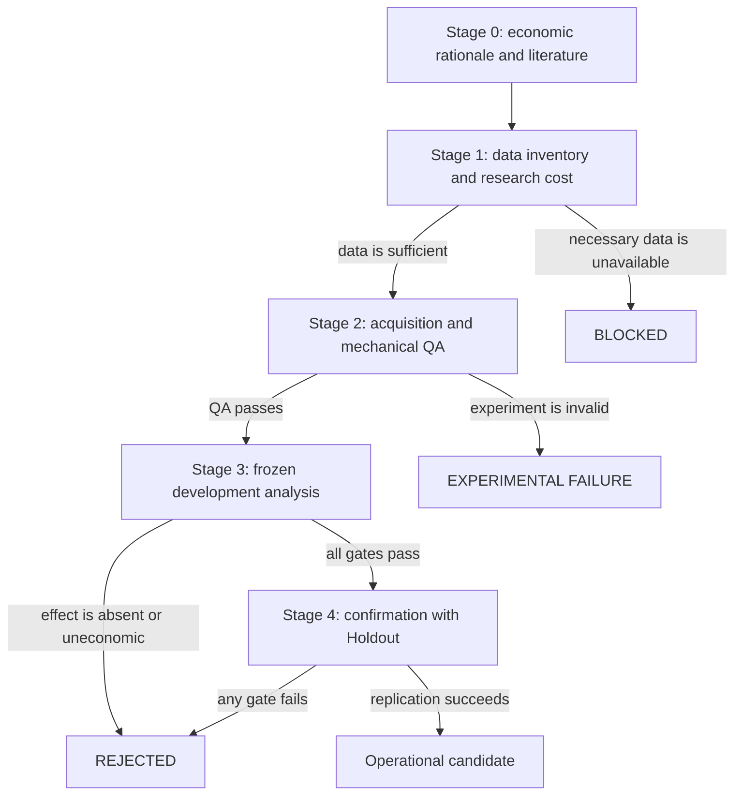

# Architecture

## Overview

The repository combines the Freqtrade engine with an independent Scientific
Framework. Freqtrade provides market-data access, persistence, models,
simulation, and backtesting. The research layer defines falsifiable Hypotheses,
runs isolated instruments, preserves Evidence, and records decisions.

No research instrument automatically becomes a strategy. Operational
development requires a separate promotion decision after every scientific and
economic gate has passed.

## System Layers

| Layer | Location | Responsibility |
|---|---|---|
| Upstream engine | `freqtrade/` | Core services, CLI, exchange integration, persistence, and backtesting |
| Configuration and examples | `config_examples/`, `user_data/` | Local configuration and user-owned entry points |
| Historical laboratory | `user_data/lab/` | Campaign management, robustness, Walk-Forward Analysis, and causal instruments |
| Phase 4 discovery | `user_data/discovery/` | Economic Hypotheses evaluated with the data then available |
| Discovery V2 | `user_data/discovery_v2/` | Governance, acquisition, mechanical QA, and derivatives research |
| Discovery V3 | `user_data/discovery_v3/` | Literature review, data inventory, QA, analysis, and scientific closure |
| Public documentation | `research/`, `reports/`, `docs/` | Curated indexes, synthesis, project history, and maintainer guidance |

## Research Pipeline

Discovery V3 ended without promoting a Hypothesis. H01, H02, and H04 were
refuted in development, so their Holdouts remained sealed.

## Integrity Boundaries

### Mechanical QA

Mechanical QA may inspect schemas, timestamps, coverage, hashes, provenance,
and alignment. It must not calculate returns, outcomes, or economic statistics.

### Economic Analysis

Economic analysis reads only the universe authorized by the Research Protocol,
uses frozen parameters, executes the registered controls, and writes the
specified matrices and decisions. The Hypothesis cannot change during
execution.

### Governance

The Scientific Ledger is append-only in the scientific sense: a rejection is
not erased because a later narrative is inconvenient. Reopening a closed line
requires materially new data, a materially new mechanism, and a new
preregistration.

### Operations

Historical operational code is physically present but scientifically separate.
Its presence does not authorize dry-run deployment or live capital.

## Research Artifact Model

The repository distinguishes four artifact classes:

| Artifact class | Examples | Git policy |
|---|---|---|
| Source | Python instruments, tests, schemas | Versioned |
| Governance | Research Protocols, Holdout seals, Scientific Ledgers | Versioned and preserved |
| Aggregate Evidence | Final reports, compact matrices, selected manifests | Versioned when suitable |
| Local data | Raw data, databases, logs, caches, credentials | Excluded |

Paths are part of Reproducibility. They may be referenced by manifests,
checksums, scripts, and recorded commands.

## Why the Upstream Layout Is Preserved

Moving `freqtrade/` into `src/`, or redistributing historical modules under
`user_data/`, would break imports, templates, Docker configuration, tests, and
recorded provenance. The open source release improves navigation with indexes
instead of rewriting the executable topology after the research concluded.

## Data Boundary

Raw data and caches remain outside Git. Public Research Artifacts include:

- preregistrations and Research Protocols;
- selected manifests and checksums;
- scientific instruments;
- aggregate matrices;
- final reports;
- Scientific Ledgers and decision records.

See the [Project Audit](PROJECT_AUDIT.md) and
[Research Index](research/README.md).
