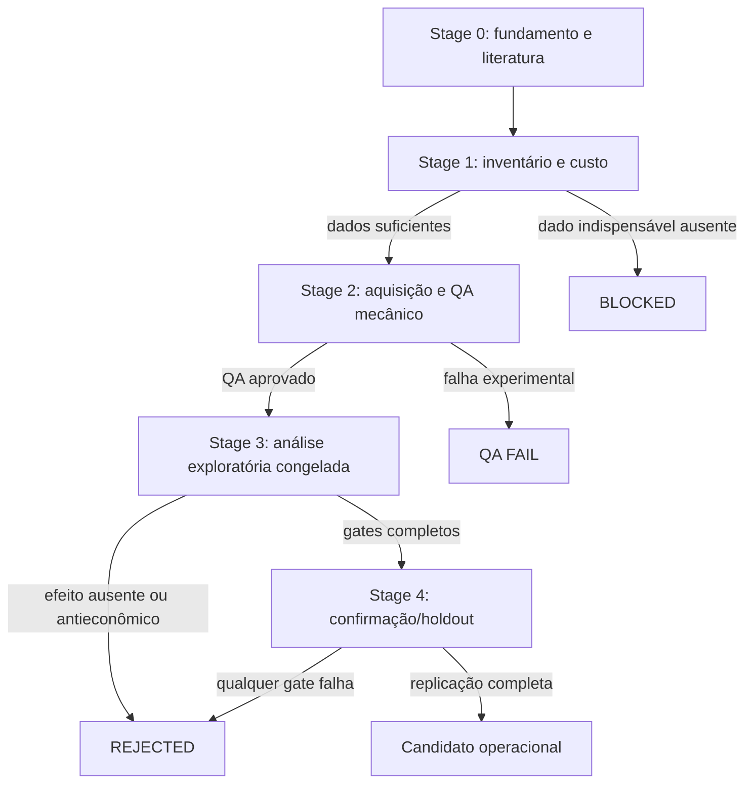

# Arquitetura

## Visão geral

O projeto combina o motor Freqtrade com uma camada científica independente. O
motor fornece acesso a dados, modelos e backtesting; o laboratório define
hipóteses, executa instrumentos isolados e registra decisões. Nenhum módulo
científico aprovado transforma automaticamente um efeito em estratégia.

## Camadas

| Camada | Local | Responsabilidade |
|---|---|---|
| Motor upstream | `freqtrade/` | Core, CLI, exchange, persistência e backtesting |
| Configuração e exemplos | `config_examples/`, `user_data/` | Configuração local e entradas do usuário |
| Laboratório histórico | `user_data/lab/` | Campanhas, robustez, walk-forward e instrumentos causais |
| Discovery Fase 4 | `user_data/discovery/` | Hipóteses econômicas baseadas no conjunto então disponível |
| Discovery V2 | `user_data/discovery_v2/` | Governança, aquisição, QA e pesquisa de derivativos |
| Discovery V3 | `user_data/discovery_v3/` | Literatura, inventário de dados, QA, análise e encerramento |
| Governança pública | `research/`, `reports/`, `docs/` | Índices, síntese, história e decisões |

## Fluxo científico

Discovery V3 encerrou antes de promover qualquer hipótese. H01, H02 e H04 foram
refutadas em desenvolvimento, portanto seus holdouts permaneceram selados.

## Fronteiras de integridade

### QA mecânico

Pode verificar schema, timestamps, cobertura, hashes, proveniência e
alinhamento. Não pode calcular retornos, outcomes ou estatísticas econômicas.

### Análise econômica

Lê apenas o universo permitido pelo protocolo, usa parâmetros congelados,
executa controles e grava matrizes e decisões. Não altera a hipótese durante a
execução.

### Governança

O ledger é append-only no sentido científico: uma decisão rejeitada não é
apagada. Reabertura exige dados e mecanismo materialmente novos.

### Operação

O código operacional histórico está separado da decisão científica. Sua
existência no repositório não implica aprovação para dry-run ou capital real.

## Por que a estrutura upstream foi preservada

Mover `freqtrade/` para `src/` ou redistribuir os módulos de `user_data/`
quebraria paths, imports, templates, Docker, testes e referências registradas.
O release organiza a navegação com índices em vez de alterar a topologia
executável após o encerramento da pesquisa.

## Dados e artefatos

Dados brutos e caches ficam fora do Git. Artefatos publicáveis são:

- pré-registros e protocolos;
- manifests e checksums de tamanho razoável;
- instrumentos Python;
- matrizes agregadas;
- relatórios finais;
- ledgers e decisões.

Veja [PROJECT_AUDIT.md](PROJECT_AUDIT.md) e
[research/README.md](research/README.md).
