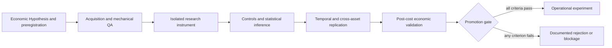

# Quantitative Research Lab

[](LICENSE)
[](https://www.python.org/)
[](docs/SCIENTIFIC_SUMMARY.md)
[](RESEARCH_HANDBOOK.md)
[](reports/README.md)
[](CONTRIBUTING.md)

A falsifiable, auditable quantitative-research environment built on
[Freqtrade](https://www.freqtrade.io/en/stable/).

This project was created to test economic Hypotheses without turning
backtesting into a search for attractive historical results. It combines
preregistered Research Protocols, mechanical data quality gates, negative
controls, multiple-testing correction, Bootstrap inference, temporal and
cross-asset replication, and explicit post-cost economic validation.

> **Scientific status:** the Research Pipeline is complete for the available
> data and registered Research Protocols. No Hypothesis demonstrated economic value,
> statistical significance, replication, robustness, stability, and
> operational feasibility at the same time. No trading bot was approved.

Rejecting unsupported Hypotheses is the central result of this repository. The
Scientific Framework prevented weak Evidence from being promoted into software
that could be mistaken for a production trading system.

## Why This Project Exists

Isolated backtests, retrospective parameter selection, and repeated
experimentation without multiplicity controls routinely produce results that
do not generalize. This laboratory reverses that workflow:

1. state an economically motivated, falsifiable Hypothesis;
2. preregister the null, estimand, controls, and stopping criteria;
3. separate data acquisition and mechanical QA from outcome analysis;
4. apply negative controls, Holm correction, and an appropriate Bootstrap;
5. require temporal and cross-asset replication;
6. evaluate economic value after realistic costs;
7. preserve the decision in the Scientific Ledger;
8. permit operational work only after every promotion gate passes.

```text
Hypothesis → Evidence → Replication → Economic Edge → Bot
```

The project never reached the final step—and that is a scientifically valid
outcome.

## Why No Hypothesis Was Promoted

The early Trend/Score, Pullback, Mean Reversion, N-of-M, and Ensemble families
failed generalization, Walk-Forward Analysis, robustness, or stability gates.
Later research moved from technical mechanisms to economic mechanisms. Some
relationships were statistically measurable, including volatility persistence
and price transmission, but none produced a robust, replicable edge after
costs.

Discovery V3 closed the remaining research program:

| Hypothesis | Decision | Decisive evidence |
|---|---|---|
| H01 — Liquidation Cascades | Rejected | Insufficient magnitude and replication |
| H02 — Spot–Perpetual Divergence | Rejected | 1.23 bp gross effect versus 30 bp cost |
| H03 — Extreme Funding | Rejected at Stage 0 | Existing Evidence was already adverse |
| H04 — Cross-Exchange Leadership | Rejected | 0.37 bp gross effect versus 15 bp cost |
| H05–H08 | Blocked | Causally necessary data was unavailable |
| H09 — Order Flow/CVD | Rejected on research budget | Scientific cost exceeded expected information value |
| H10 — Relative Strength | Rejected at Stage 0 | It would reopen a closed OHLCV conclusion without new data |

“Blocked” is intentionally distinct from “Rejected”: unavailable data is not
Evidence against a mechanism. In both cases, the promotion gate remains closed.

See the [Scientific Summary](docs/SCIENTIFIC_SUMMARY.md), the
[Discovery V3 final report](user_data/discovery_v3/final/DISCOVERY_V3_FINAL_SCIENTIFIC_REPORT.md),
and the [definitive Scientific Ledger](user_data/discovery_v3/governance/SCIENTIFIC_LEDGER.md).

## Architecture



The Freqtrade engine remains intact beneath an independent research layer:

- `freqtrade/` — preserved upstream engine;
- `user_data/lab/` — historical research infrastructure and instruments;
- `user_data/discovery/` — Phase 4 instruments and Evidence;
- `user_data/discovery_v2/` — acquisition, QA, and Governance for Discovery V2;
- `user_data/discovery_v3/` — final-generation reviews, data gates, analyses,
  and Scientific Ledger;
- `research/` — curated entry point to Research Protocols and decisions;
- `reports/` — curated entry point to final reports;
- `docs/` — architecture, history, design decisions, and lessons learned.

See [Architecture](ARCHITECTURE.md) for component boundaries and integrity
rules.

## Research Workflow

Each campaign follows the same Research Pipeline:

1. **Economic rationale** — explain why the effect could exist.
2. **Literature and cost review** — reject low-value work before implementation.
3. **Preregistration** — freeze the Hypothesis, controls, estimand, and gates.
4. **Acquisition and QA** — validate schema, coverage, alignment, provenance,
   and checksums without observing outcomes.
5. **Development analysis** — run exactly the registered instrument.
6. **Inference and controls** — use the registered Bootstrap, Holm correction,
   and negative controls.
7. **Replication** — require consistency across time and assets.
8. **Economic validation** — compare the effect with execution costs and
   operational constraints.
9. **Governance** — record `CONFIRMED`, `REJECTED`, `BLOCKED`, or experimental
   failure in the Scientific Ledger.

A Holdout remains sealed when development Evidence already refutes the
Hypothesis. Statistical independence is not consumed for curiosity.

## Installation

Requirements:

- Python 3.11 or later;
- Git;
- the native dependencies required by Freqtrade, including TA-Lib;
- Docker, optional.

```bash
git clone https://github.com/renatofd/quant-research-lab.git
cd quant-research-lab
python -m venv .venv
python -m pip install --upgrade pip
python -m pip install -e .
```

For development:

```bash
python -m pip install -r requirements-dev.txt
pre-commit run --all-files
pytest
```

The complete engine setup remains documented in the
[official Freqtrade installation guide](https://www.freqtrade.io/en/stable/installation/).
Installation makes the framework available; it does not enable or approve live
trading.

## Repository Structure

```text
.
├── freqtrade/                  # Upstream engine
├── user_data/
│   ├── lab/                    # Historical Scientific Framework
│   ├── discovery/              # Phase 4 research
│   ├── discovery_v2/           # Derivatives research and data Governance
│   └── discovery_v3/           # Final research generation
├── research/                   # Research index
├── reports/                    # Report index
├── docs/                       # Maintainer and portfolio documentation
├── ARCHITECTURE.md
├── PROJECT_AUDIT.md
└── SECURITY_AUDIT.md
```

Historical paths are preserved because they appear in manifests, hashes,
recorded commands, and provenance records.

## Reproducibility

The public snapshot includes source code, preregistrations, selected manifests,
structured decisions, and aggregate Research Artifacts. It intentionally
excludes the local multi-gigabyte data lake, databases, caches, logs, and
credentials.

To audit a result:

1. read the Research Protocol and Scientific Ledger before the narrative report;
2. verify the registered period, universe, costs, seed, and hashes;
3. acquire data only from the declared sources and endpoints;
4. verify coverage and checksums;
5. preserve the Holdout boundary;
6. run only the instrument associated with that Hypothesis;
7. compare structured Research Artifacts with the published decision.

Re-running an analysis on consumed data does not create a new Holdout and does
not justify variant selection. See the
[Publication Guide](docs/PUBLICATION_GUIDE.md) and [Research Index](research/README.md).

## Limitations

- Conclusions are conditional on the registered universes, periods, timeframes,
  costs, and Research Protocols.
- The OHLCV development periods used by the closed programs are no longer
  untouched Holdouts.
- Candles do not identify spread, depth, queue position, latency, aggressor,
  liquidations, or executable order-book state.
- H05–H08 require point-in-time data that was not available with adequate
  provenance.
- Risk predictability is not, by itself, a directional trading edge.
- Historical strategy code is retained for Reproducibility; it is not approved
  for live capital.

## Future Work

The closed research lines will not be reopened with new parameters on the same
data. A future research generation would require materially new, point-in-time
data and a prospectively reserved Holdout. Candidate data classes include:

- sequenced order books paired with trades;
- versioned on-chain labels with knowledge timestamps;
- official ETF flow vintages;
- executable historical options surfaces.

See the [Roadmap](ROADMAP.md) for the decision criteria that must be satisfied
before any new campaign begins.

## Security and Responsible Use

This repository is an educational Research Artifact. It is not financial
advice, a signal service, or a production trading system. Never commit
`user_data/config.json`, `.env` files, local databases, or exchange credentials.
Read the [Security Policy](SECURITY.md) and [Security Audit](SECURITY_AUDIT.md).

## Citation

Use the metadata in [CITATION.cff](CITATION.cff) when citing this project. The
same file includes the DOI for the upstream Freqtrade paper.

## Contributing

Contributions are welcome in methodology review, Reproducibility, tests,
documentation, and the evaluation of materially new datasets. Parameter tuning
of rejected Hypotheses is out of scope. See [Contributing](CONTRIBUTING.md) and
the [Code of Conduct](CODE_OF_CONDUCT.md).

## License and Attribution

This project is derived from Freqtrade and preserves its architecture, history,
and attribution. The combined work is distributed under the
[GNU General Public License v3 or later](LICENSE); it cannot be relicensed as
MIT without violating upstream copyleft obligations. See [NOTICE.md](NOTICE.md)
for attribution details.
