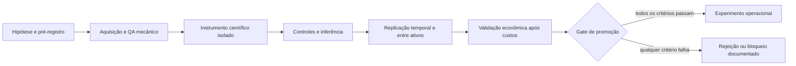

# Quantitative Research Lab

Um laboratório científico de pesquisa quantitativa construído sobre o
[Freqtrade](https://www.freqtrade.io/). O projeto foi criado para testar
hipóteses econômicas de forma falsificável, auditável e resistente a
overfitting — não para encontrar retrospectivamente o backtest mais lucrativo.

> **Status científico:** pesquisa encerrada sob os dados e protocolos atuais.
> Nenhuma hipótese atingiu simultaneamente vantagem econômica, significância,
> replicação, robustez, estabilidade e viabilidade operacional. Nenhum bot foi
> aprovado.

**O framework rejeitou todas as hipóteses testadas e isso representa sucesso
metodológico, não fracasso.**

## Por que este projeto existe

Backtests isolados, seleção retrospectiva de parâmetros e múltiplas tentativas
sem controle produzem resultados atraentes que raramente generalizam. Este
laboratório inverte esse processo:

1. propõe um mecanismo econômico;
2. pré-registra hipótese, nulidade e critérios de parada;
3. separa aquisição/QA de análise econômica;
4. usa controles negativos, correção de multiplicidade e bootstrap;
5. exige replicação temporal e entre ativos;
6. testa relevância econômica após custos;
7. promove para operação somente o que sobreviver a todos os gates.

O caminho obrigatório é:

```text
Hipótese → Evidência → Replicação → Vantagem econômica → Bot
```

## Resultado executivo

As famílias Trend/Score, Pullback, Mean Reversion, N-of-M e Ensemble não
generalizaram. A investigação posterior de mecanismos econômicos encontrou
relações estatísticas — por exemplo, persistência de volatilidade e transmissão
de preços — mas nenhuma vantagem líquida replicável que justificasse operação.

No Discovery V3:

| Hipótese | Decisão | Motivo decisivo |
|---|---|---|
| H01 — Liquidation Cascades | Rejeitada | Falhou magnitude e replicação |
| H02 — Spot × Perp Divergence | Rejeitada | 1,23 bp bruto versus 30 bp de custo |
| H03 — Extreme Funding | Rejeitada no Stage 0 | Evidência anterior já negativa |
| H04 — Cross-Exchange Leadership | Rejeitada | 0,37 bp bruto versus 15 bp de custo |
| H05–H08 | Bloqueadas | Faltam dados causalmente indispensáveis |
| H09 — Order Flow/CVD | Rejeitada por orçamento | Custo científico maior que a informação esperada |
| H10 — Relative Strength | Rejeitada no Stage 0 | Reabriria conclusão OHLCV sem dado novo |

Leia o [resumo científico](docs/SCIENTIFIC_SUMMARY.md), o
[relatório final do Discovery V3](user_data/discovery_v3/final/DISCOVERY_V3_FINAL_SCIENTIFIC_REPORT.md)
e o [ledger definitivo](user_data/discovery_v3/governance/SCIENTIFIC_LEDGER.md).

## Arquitetura



- `freqtrade/`: motor upstream preservado.
- `user_data/lab/`: infraestrutura e instrumentos científicos históricos.
- `user_data/discovery/`: instrumentos e resultados da Fase 4.
- `user_data/discovery_v2/`: aquisição, QA e governança do Discovery V2.
- `user_data/discovery_v3/`: última geração, incluindo relatórios finais.
- `research/`: índice público de protocolos, hipóteses e ledgers.
- `reports/`: índice público de resultados finais.
- `docs/`: história, decisões, lições e orientação para publicação.

Detalhes em [ARCHITECTURE.md](ARCHITECTURE.md).

## Princípios científicos

- uma hipótese ativa por vez;
- nenhum retuning após observar o outcome;
- holdout selado antes da análise e preservado quando o desenvolvimento refuta;
- controles negativos e correção de Holm;
- bootstrap em unidades temporais apropriadas, não em candles independentes;
- replicação temporal e entre ativos;
- custos econômicos avaliados antes de qualquer promoção;
- resultados negativos mantidos no ledger;
- proxies não substituem o mecanismo que pretendem representar;
- significância estatística não equivale a vantagem executável.

## Instalação

Requisitos principais:

- Python 3.11 ou superior;
- Git;
- dependências nativas exigidas pelo Freqtrade, incluindo TA-Lib;
- Docker, opcional.

```bash
git clone <URL_DO_REPOSITORIO>
cd <DIRETORIO_DO_REPOSITORIO>
python -m venv .venv
python -m pip install --upgrade pip
python -m pip install -e .
```

Para desenvolvimento:

```bash
python -m pip install -r requirements-dev.txt
pre-commit run --all-files
pytest
```

As instruções completas do motor base permanecem na
[documentação oficial do Freqtrade](https://www.freqtrade.io/en/stable/installation/).

## Reprodução responsável

O snapshot público inclui código, pré-registros, decisões, manifests selecionados
e relatórios finais. Dados brutos, caches, bancos, logs e credenciais locais não
devem ser versionados.

Para auditar os resultados:

1. leia o protocolo e o ledger antes do relatório;
2. confira o período, universo, custos, seed e hash registrados;
3. obtenha os dados exclusivamente das fontes e endpoints declarados;
4. verifique checksums e cobertura;
5. mantenha o holdout selado;
6. execute apenas o instrumento da hipótese correspondente;
7. compare artefatos estruturais e decisão com o relatório publicado.

Reexecutar análises em dados consumidos não cria um novo holdout e não autoriza
seleção de variantes. Consulte [PUBLICATION_GUIDE.md](docs/PUBLICATION_GUIDE.md)
e [research/README.md](research/README.md).

## Limitações

- os resultados são condicionais aos universos, períodos, timeframes e custos
  pré-registrados;
- períodos OHLCV utilizados foram consumidos em desenvolvimento;
- candles não identificam spread, profundidade, fila, latência, agressor,
  liquidações ou execução;
- dados indispensáveis para H05–H08 não estavam disponíveis com provenance
  point-in-time adequado;
- relações preditivas de risco não são, por si, sinais direcionais;
- o código operacional histórico é material de pesquisa, não software aprovado
  para capital real.

## Uso e segurança

Este repositório é educacional e científico. Não oferece aconselhamento
financeiro e não contém estratégia aprovada para negociação. Nunca publique
`user_data/config.json`, arquivos `.env`, bancos locais ou chaves de exchange.
Comece pela [política de segurança](SECURITY.md) e pela
[auditoria de segurança](SECURITY_AUDIT.md).

## FAQ

### Existe um bot pronto para operar?

Não. A conclusão formal é que não existe evidência suficiente para justificar
um bot operacional.

### Por que publicar resultados negativos?

Porque eles reduzem o espaço de hipóteses, impedem repetição de erros e mostram
um processo que prefere falsificação a cherry-picking.

### Posso otimizar novamente uma hipótese rejeitada?

Não dentro da mesma base científica. Reabertura exige mecanismo materialmente
novo, dados novos e um protocolo novo pré-registrado antes de observar outcomes.

### Por que os dados brutos não estão no Git?

O volume local supera vários gigabytes e inclui artefatos reproduzíveis a partir
de fontes declaradas. Manifests, checksums e provenance são a interface adequada
para auditoria; Git não é um data lake.

### Posso contribuir?

Sim, sobretudo em auditoria metodológica, testes, documentação e novos datasets
com provenance. Leia [CONTRIBUTING.md](CONTRIBUTING.md).

## Roadmap

O programa científico atual está encerrado. O trabalho futuro permitido é:

- manutenção de reprodutibilidade, testes e documentação;
- auditoria independente dos artefatos publicados;
- avaliação de novos datasets point-in-time antes de qualquer hipótese;
- eventual nova geração somente com livro sequenciado, labels on-chain
  versionados, fluxos oficiais de ETF ou superfície histórica executável de
  opções.

Veja [ROADMAP.md](ROADMAP.md).

## Origem, citação e licença

Este projeto deriva do Freqtrade e preserva sua arquitetura, histórico e
atribuição. Cite o laboratório por meio de [CITATION.cff](CITATION.cff) e o
Freqtrade pelo DOI indicado nesse arquivo.

O código base é distribuído sob **GNU GPL v3 ou posterior**. A licença não foi
substituída por MIT porque uma redistribuição derivada do Freqtrade deve
preservar as obrigações de copyleft do projeto original. Consulte
[LICENSE](LICENSE) e [NOTICE.md](NOTICE.md).
